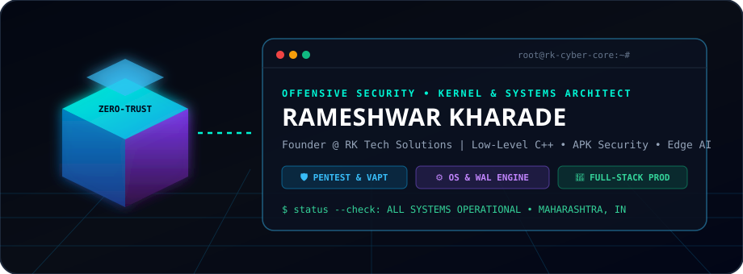

<!-- 3D Cyber-Security Holographic Hero -->

 

<!-- Neon Cyber Terminal Typing Effect -->

 

<!-- 3D Action & Live Deployment Badges -->

  
  
  
  

 

<!-- 3D Isometric Engineering & Cyber Matrix -->

---

### 🛡️ Flagship Cyber Security, Systems & Production Repositories

<table>
  <tr>
    <td width="50%" valign="top">
      <h4>🔐 Cyber Defense &amp; Security Tooling</h4>
      <ul>
        <li><b><a href="https://rktechsolution.vercel.app">RK Tech Solutions</a></b> — Enterprise Web Security Audits (SQLi/XSS/Auth), Android APK Binary Hardening &amp; Custom Engineering Storefront.</li>
        <li><b><a href="https://github.com/rameshwarkharade001-byte/rk-tech-store">RK Tech Store</a></b> — Direct-from-engineer security &amp; automation storefront with instant UPI &amp; WhatsApp workflow.</li>
        <li><b>Security Research Lab</b> — Local Nmap port reconnaissance, OWASP vulnerability exploitation labs &amp; static APK manifest/secret extraction.</li>
      </ul>
    </td>
    <td width="50%" valign="top">
      <h4>⚙️ Bare-Metal OS &amp; High-Speed Storage</h4>
      <ul>
        <li><b><a href="https://github.com/rameshwarkharade001-byte/AetherOS">AetherOS</a></b> — 32-bit Bare-Metal Protected-Mode Microkernel &amp; Hardware Shell engineered from scratch in <b>C++ &amp; x86 Assembly</b>.</li>
        <li><b><a href="https://github.com/rameshwarkharade001-byte/AetherDB">AetherDB</a></b> — High-throughput concurrent in-memory Key-Value Storage Engine built in <b>C++20</b> with Write-Ahead Logging (WAL) crash recovery.</li>
        <li><b><a href="https://github.com/rameshwarkharade001-byte/k6-compiler-load-test">K6 Load Engine</a></b> — High-concurrency distributed load &amp; stress-testing pipeline for compiler &amp; API resilience.</li>
      </ul>
    </td>
  </tr>
  <tr>
    <td width="50%" valign="top">
      <h4>🧠 Edge AI, Computer Vision &amp; Compilers</h4>
      <ul>
        <li><b><a href="https://github.com/rameshwarkharade001-byte/sentinel-hud">Sentinel HUD</a></b> — Autonomous driver drowsiness detection &amp; micro-sleep countermeasure HUD built in <b>HTML, JS &amp; C++</b> with zero external AI APIs.</li>
        <li><b><a href="https://github.com/rameshwarkharade001-byte/online-compiler">Online Multi-Language Compiler</a></b> — Browser-based code execution sandbox with instant syntax evaluation &amp; live output streaming.</li>
      </ul>
    </td>
    <td width="50%" valign="top">
      <h4>🚀 Live Full-Stack &amp; Android Applications</h4>
      <ul>
        <li><b><a href="https://github.com/rameshwarkharade001-byte/kids-tone-pro">Kids Tone PRO</a></b> (<a href="https://kids-tone-pro.vercel.app">Live App ↗</a>) — Edge-cached streaming web platform &amp; Android APK featuring Touch-Lock player, Draw Pad &amp; Web Audio Piano.</li>
        <li><b><a href="https://github.com/rameshwarkharade001-byte/Calculator-pro">CalcForge Pro</a></b> — Offline precision scientific utility compiled directly into a standalone Android APK.</li>
      </ul>
    </td>
  </tr>
</table>

---

### ⚡ Offensive & Systems Engineering Arsenal

---

### 📊 Live Telemetry & Contribution Matrix

 

  

