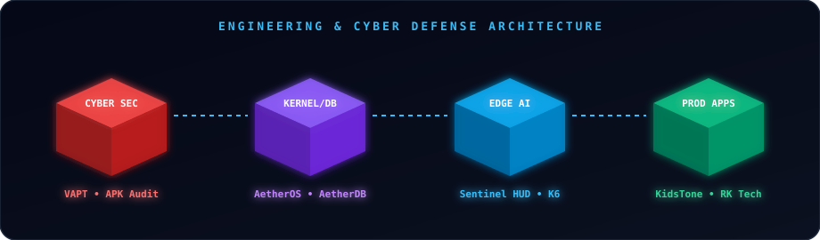
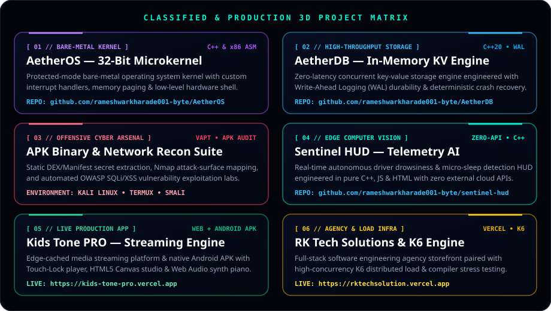
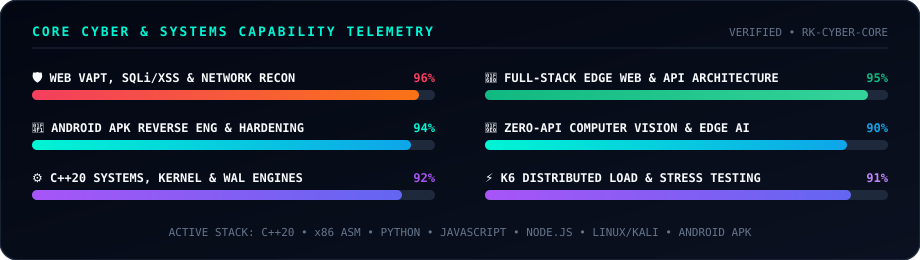

<!-- Live Animated 3D Cyber Gyroscope & Laser-Scan Hero -->

 

<!-- 3D Neon Action & Live Deployment Badges -->

  
  
  
  

 

<!-- 3D Isometric Engineering & Cyber Matrix -->

 

<!-- 3D Neon Holographic Project Cards (No Plain Tables) -->

---

### ⚡ Offensive & Systems Engineering Arsenal

---

### 📊 Live Telemetry & Contribution Matrix

 

 

